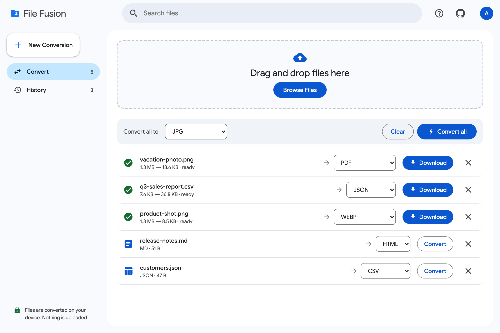

```text

  ███████╗██╗██╗     ███████╗   ███████╗██╗   ██╗███████╗██╗ ██████╗ ███╗   ██╗
  ██╔════╝██║██║     ██╔════╝   ██╔════╝██║   ██║██╔════╝██║██╔═══██╗████╗  ██║
  █████╗  ██║██║     █████╗     █████╗  ██║   ██║███████╗██║██║   ██║██╔██╗ ██║
  ██╔══╝  ██║██║     ██╔══╝     ██╔══╝  ██║   ██║╚════██║██║██║   ██║██║╚██╗██║
  ██║     ██║███████╗███████╗   ██║     ╚██████╔╝███████║██║╚██████╔╝██║ ╚████║
  ╚═╝     ╚═╝╚══════╝╚══════╝   ╚═╝      ╚═════╝ ╚══════╝╚═╝ ╚═════╝ ╚═╝  ╚═══╝

        convert any file  ·  right in your browser  ·  free & open source
```

# File Fusion

[](https://ybelov27.github.io/FileFusion/)
[](https://github.com/ybelov27/FileFusion/actions/workflows/pages.yml)
[](https://github.com/ybelov27/FileFusion/stargazers)
[](https://github.com/ybelov27/FileFusion/commits)
[](LICENSE)
[](https://github.com/ybelov27/FileFusion)




This repository contains the core logic for a modular file conversion system, named File Fusion.

It also contains the web app in `ui/`: a landing page and a converter that runs entirely in the browser (images to PNG/JPG/WEBP/PDF/BMP/ICO/Base64, audio to WAV, CSV/TSV/JSON/JSON Lines/XML to JSON/CSV/TSV/JSON Lines/Markdown/HTML/YAML/XML/SQL, and Markdown/HTML/text to HTML/Markdown/text/PDF). It is deployed to GitHub Pages at https://ybelov27.github.io/FileFusion/.

## Web App

To run the web app locally, you can use Python's built-in HTTP server.

1. Navigate to the `ui` directory:
   ```bash
   cd ui
   ```

2. Start a local web server:
   ```bash
   python -m http.server 8000
   ```

3. Open your web browser and navigate to:
   * Landing Page: `http://localhost:8000/`
   * App UI: `http://localhost:8000/app.html`

### Google sign-in

Sign-in uses Google Identity Services and is optional; it stays hidden until a client ID is configured.

1. In the [Google Cloud console](https://console.cloud.google.com/apis/credentials), create an OAuth client ID of type **Web application**.
2. Under **Authorized JavaScript origins**, add `https://ybelov27.github.io` and `http://localhost:8000`.
3. Paste the client ID into `ui/config.js` as `googleClientId`.

## Core System Development

To work on the core system or run the unit tests:

1. Install pytest:
   ```bash
   pip install pytest
   ```

2. Run the tests from the root of the repository:
   ```bash
   pytest tests/
   ```

## License

File Fusion is released under the [MIT License](LICENSE).
